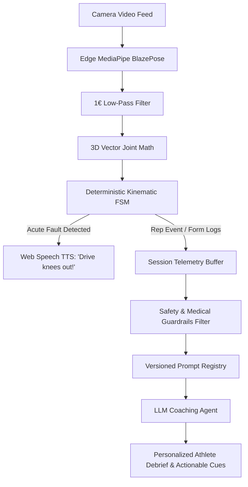

# AI Architecture: Hybrid Deterministic & Generative Coaching System

## Architectural Overview
The AI Coaching System employs a **two-tier hybrid architecture**:
1. **Tier 1 (Edge Deterministic Perception & Safety Engine)**: Runs client-side at 30-60 FPS using MediaPipe BlazePose and mathematical kinematic state machines. Evaluates raw joint vectors, detects acute form degradation (valgus collapse, lumbar shear), and triggers instant auditory alerts ($<150\text{ ms}$).
2. **Tier 2 (Asynchronous LLM Reasoning & Periodization Agent)**: Evaluates aggregated workout telemetry, fatigue velocity trends, and athlete history to generate personalized post-set and post-workout debriefs, corrective exercise programming, and macro coaching.

---

## 1. Two-Tier Responsibilities & Boundaries

| Responsibility | Tier 1: Deterministic Edge Engine | Tier 2: Generative LLM Coaching Agent |
| :--- | :--- | :--- |
| **Rep Counting** | **Authoritative**: Evaluates angle hysteresis ($160^\circ \to 90^\circ \to 160^\circ$). | Never counts reps (avoids hallucination). |
| **Form Safety Alerting** | **Authoritative**: Instant $(<150\text{ ms})$ auditory warning. | Summarizes form errors post-workout. |
| **Latency Requirement** | $\le 30\text{ ms}$ compute per frame. | $\le 1,200\text{ ms}$ streaming text response. |
| **Execution Environment** | Client Browser / WebAssembly / WebGL. | Asynchronous Server / Cloud API / Local Mock. |
| **Privacy Footprint** | Raw pixels in volatile GPU memory; zero upload. | Anonymized discrete metrics (reps, angles, timestamps). |
| **Tone & Empathy** | Concise imperative commands (*"Chest up"*). | Contextual, motivational, constructive coaching. |

---

## 2. LLM Tool Calling & Guardrails Flow

When the athlete interacts with the coach (e.g. via `CoachChatDrawer` or post-session summary):
1. **Input Normalization**: User text and workout context are cleaned of PII.
2. **Medical Guardrail Interceptor**: Checks input for emergency orthopedic symptoms (sharp tearing sensations, joint dislocation, chest pain). If detected, triggers immediate medical disclaimer and halts guidance.
3. **Prompt Assembly**: The registry loads the versioned system constitution (`coach_summary_v1.0.0` or `live_cue_v1.0.0`) injecting athlete profile, experience tier, and current workout telemetry.
4. **Structured JSON Validation**: Model outputs are validated against Zod / Pydantic schemas (`CoachQueryResponse`), guaranteeing that `actionable_cues`, `confidence_score`, and `safety_disclaimer` are present.
5. **Fallback Cascade**: If the LLM provider fails, times out ($>2,500\text{ ms}$), or exhibits token degradation, the system gracefully falls back to deterministic rule-based template generation without breaking the user experience.
