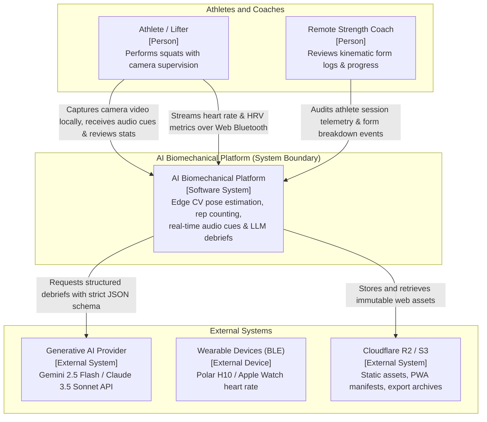

# C4 Architecture: System Context

## System Context Diagram
The System Context diagram illustrates the AI Biomechanical Fitness Platform, its human actors, and external system integrations.

---

## 1. Primary Actors
- **Athlete / Lifter**: Primary user executing training movements in front of a web camera or smartphone. Receives real-time spoken cues, visual HUD angles, and post-session coaching summaries.
- **Remote Strength Coach (CSCS)**: Secondary user reviewing high-resolution kinematic timelines, form breakdown alerts, and longitudinal performance trends for clients.

---

## 2. External System Integrations
- **Generative AI Provider**: Cloud LLM API queried asynchronously for natural language debrief synthesis, nutrition planning, and periodization logic.
- **Bluetooth Low Energy (BLE) Wearables**: Local Web Bluetooth connection with chest-strap heart rate monitors (Polar H10) and smartwatches for Zone 1-5 aerobic tracking.
- **Static Object Storage (S3 / R2)**: Hosts compiled client bundles, PWA service worker manifests, and exportable data archives.
