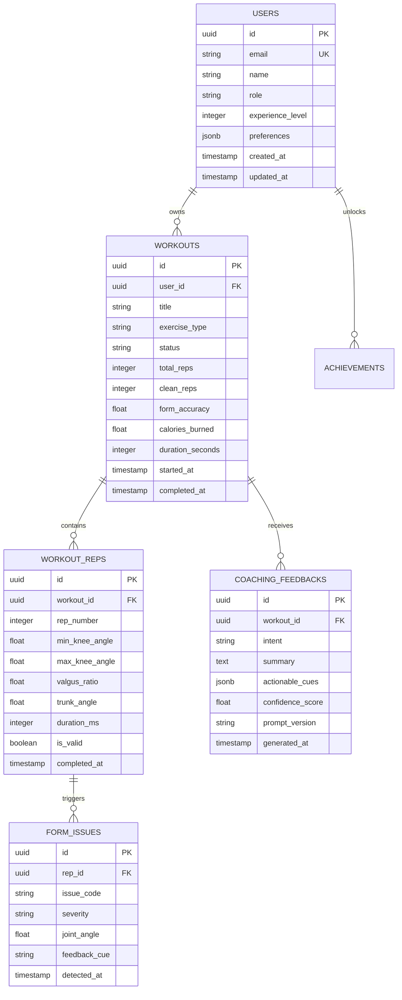

# Data Model & Relational Schema Architecture

## 1. Entity-Relationship Diagram (ERD)

---

## 2. Table Specifications & Indexing Strategy

### A. `users` Table
- Stores athlete and coach account profiles, authorization roles, and preferences.
- **Indexes**:
  - `idx_users_email` (UNIQUE): Fast lookups on authentication.
  - `idx_users_created_at`: Range queries for cohort analytics.

### B. `workouts` Table
- Represents a discrete training session targeting one or more exercises.
- **Columns**: `id`, `user_id`, `title`, `exercise_type`, `status` (`in_progress`, `completed`, `abandoned`), `total_reps`, `clean_reps`, `form_accuracy`, `calories_burned`, `duration_seconds`.
- **Indexes**:
  - `idx_workouts_user_id`: Fast query for athlete workout history.
  - `idx_workouts_completed_at`: Ordering by recency.

### C. `workout_reps` Table
- Granular kinematic record for every single completed or rejected repetition.
- **Columns**: `id`, `workout_id`, `rep_number`, `min_knee_angle`, `max_knee_angle`, `valgus_ratio`, `trunk_angle`, `duration_ms`, `is_valid`.
- **Indexes**:
  - `idx_workout_reps_workout_id`: Fetches all reps for a given session.
  - `idx_workout_reps_is_valid`: Quickly isolates invalid reps for form analytics.

### D. `form_issues` Table
- Records discrete biomechanical breakdown occurrences.
- **Columns**: `id`, `rep_id`, `issue_code` (`KNEE_VALGUS`, `SHALLOW_DEPTH`, `FORWARD_TRUNK_LEAN`), `severity` (`low`, `moderate`, `severe`), `joint_angle`, `feedback_cue`.
- **Indexes**:
  - `idx_form_issues_rep_id`: Foreign key lookup.
  - `idx_form_issues_code`: Aggregate queries for identifying athlete-specific weaknesses.

### E. `coaching_feedbacks` Table
- Persistent record of structured LLM coach responses.
- **Columns**: `id`, `workout_id`, `intent`, `summary`, `actionable_cues` (JSONB), `confidence_score`, `prompt_version`.
- **Indexes**:
  - `idx_coaching_feedbacks_workout_id`: Session association.
