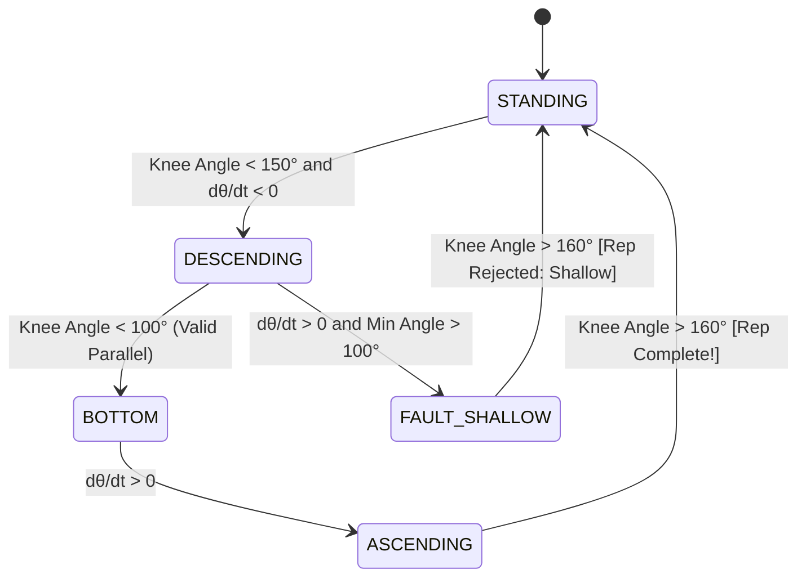

# Biomechanical Form Rules & Kinematic Thresholds

## Overview
This document formalizes the mathematical logic, threshold constants, and temporal hysteresis windows used to evaluate repetition validity and form defects in the Squat State Machine.

---

## 1. Squat State Machine Threshold Constants

| Constant Identifier | Value | Unit | Definition |
| :--- | :--- | :--- | :--- |
| `SQUAT_STANDING_ANGLE` | $160.0$ | Degrees | Angle above which the lifter is considered fully standing. |
| `SQUAT_DESCENT_TRIGGER` | $150.0$ | Degrees | Upper inflection threshold indicating descent has begun. |
| `SQUAT_PARALLEL_DEPTH` | $100.0$ | Degrees | Maximum knee angle permissible to register a valid parallel rep. |
| `SQUAT_DEEP_DEPTH` | $85.0$ | Degrees | Knee angle indicating full below-parallel / Olympic depth. |
| `SQUAT_HYSTERESIS_DELTA` | $5.0$ | Degrees | Buffer window preventing flutter oscillations near state boundaries. |
| `VALGUS_COLLAPSE_RATIO` | $0.82$ | Ratio | Coronal distance ratio below which knee valgus is flagged. |
| `TRUNK_LEAN_MAX_DEGREES` | $45.0$ | Degrees | Forward torso pitch limit before excessive lumbar shear is flagged. |
| `MIN_REP_DURATION_MS` | $800$ | Milliseconds | Minimum duration of a valid rep (prevents noisy double counting). |
| `AUDIO_THROTTLE_MS` | $2500$ | Milliseconds | Minimum quiet period between repeated verbal cues. |

---

## 2. Finite State Transition Diagram

---

## 3. Kinetic & Kinematic Form Defect Definitions

### Defect 1: Dynamic Knee Valgus (`KNEE_VALGUS`)
- **Clinical Implication**: Inward medial collapse places high valgus torque on the Anterior Cruciate Ligament (ACL) and patellofemoral joint.
- **Rule**:
  $$\text{if } R_{valgus} < 0.82 \text{ and } \text{stage} \in \{\text{BOTTOM}, \text{ASCENDING}\}:$$
  $$\text{emit}(\text{FormIssue}(\text{code} = \text{"KNEE\_VALGUS"}, \text{cue} = \text{"Drive knees out over toes"}))$$

### Defect 2: Shallow Depth (`SHALLOW_DEPTH`)
- **Clinical Implication**: Decreased gluteus maximus recruitment; invalidates competition standards.
- **Rule**:
  $$\text{if } \text{concentric reversal happens while } \theta_{min} > 100^\circ:$$
  $$\text{emit}(\text{FormIssue}(\text{code} = \text{"SHALLOW\_DEPTH"}, \text{cue} = \text{"Descend deeper to parallel"}))$$

### Defect 3: Excessive Trunk Tilt (`FORWARD_TRUNK_LEAN`)
- **Clinical Implication**: Increases lumbar shear force at the L4-L5 and L5-S1 vertebral motion segments.
- **Rule**:
  $$\text{if } \theta_{trunk} > 45^\circ \text{ and } \theta_{knee} < 130^\circ:$$
  $$\text{emit}(\text{FormIssue}(\text{code} = \text{"FORWARD\_TRUNK\_LEAN"}, \text{cue} = \text{"Keep chest proud and upright"}))$$
