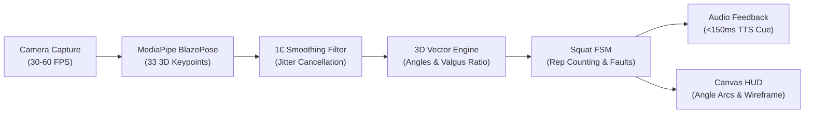

# Computer Vision Pose Pipeline & Real-Time Kinematics

## 1. End-to-End Pipeline Architecture
The Computer Vision Pose Pipeline captures real-time video frames from commodity cameras, estimates 33 3D skeletal landmarks at the edge, conditions coordinates using adaptive low-pass filtering, computes anatomical joint angles, and feeds a deterministic state machine.

---

## 2. Keypoint Topography (MediaPipe BlazePose)
The pipeline tracks the following subset of standard 33 BlazePose landmarks:

| Landmark ID | Anatomical Joint Name | Coordinate Space | Purpose in Squat Pipeline |
| :--- | :--- | :--- | :--- |
| **0** | Nose | $x, y, z$ | Head orientation and gaze direction |
| **11, 12** | Left, Right Shoulder | $x, y, z$ | Upper trunk axis and spinal alignment |
| **23, 24** | Left, Right Hip | $x, y, z$ | Hip crease depth, pelvis center, trunk angle |
| **25, 26** | Left, Right Knee | $x, y, z$ | Knee flexion vertex, frontal knee valgus collapse |
| **27, 28** | Left, Right Ankle | $x, y, z$ | Knee-ankle lateral ratio, foot placement base |
| **31, 32** | Left, Right Foot Index (Toes) | $x, y, z$ | Foot flare angle and center of pressure estimation |

---

## 3. Signal Conditioning: Adaptive 1€ Filter
Raw video landmark detection exhibits high-frequency jitter (camera sensor noise, lighting variations). A standard low-pass filter introduces unwanted phase lag during rapid transitions.
We implement the **1€ (One Euro) adaptive filter** featuring:
- Low cutoff frequency ($\beta = 0.007$, $f_{c,min} = 1.0\text{ Hz}$) when movement velocity is low (standing still, stabilizing).
- High cutoff frequency ($f_c$ scales linearly with velocity $\dot{x}$) during rapid eccentric/concentric movements, ensuring **zero noticeable phase delay** while maintaining smooth visual overlays.

---

## 4. 3D Vector Angle Mathematics

### A. Knee Flexion Angle ($\theta_{knee}$)
Formed by the 3D ray from Hip ($H$) to Knee ($K$) and Knee ($K$) to Ankle ($A$):
$$\vec{u} = \vec{H} - \vec{K}, \quad \vec{v} = \vec{A} - \vec{K}$$
$$\theta_{knee} = \arccos\left(\frac{\vec{u} \cdot \vec{v}}{\|\vec{u}\| \|\vec{v}\|}\right) \times \frac{180}{\pi}$$
- **Standing Extension**: $\approx 170^\circ - 180^\circ$
- **Parallel Threshold**: $\le 100^\circ$
- **Deep Squat**: $\le 85^\circ$

### B. Frontal-Plane Knee Valgus Collapse Ratio ($R_{valgus}$)
In the coronal plane ($x, y$), the ratio of inter-knee distance to inter-ankle distance:
$$R_{valgus} = \frac{|x_{left\_knee} - x_{right\_knee}|}{|x_{left\_ankle} - x_{right\_ankle}|}$$
- **Healthy Anatomical Tracking**: $R_{valgus} \ge 0.90$
- **Mild Medial Displacement**: $0.80 \le R_{valgus} < 0.90$
- **Acute Valgus Collapse (Fault)**: $R_{valgus} < 0.80$ (Triggers instant *"Drive knees out"* cue)

### C. Trunk Lean Angle ($\theta_{trunk}$)
Angle formed between the trunk axis (Mid-Hip to Mid-Shoulder) and the vertical gravity vector $\vec{g} = (0, -1, 0)$:
$$\vec{t} = \vec{M}_{shoulder} - \vec{M}_{hip}$$
$$\theta_{trunk} = \arccos\left(\frac{\vec{t} \cdot \vec{g}}{\|\vec{t}\| \|\vec{g}\|}\right) \times \frac{180}{\pi}$$
- **Optimal High-Bar / Bodyweight**: $15^\circ - 35^\circ$
- **Low-Bar Back Squat**: $30^\circ - 45^\circ$
- **Excessive Forward Lean (Fault)**: $> 48^\circ$ (Triggers *"Chest up"* cue)
