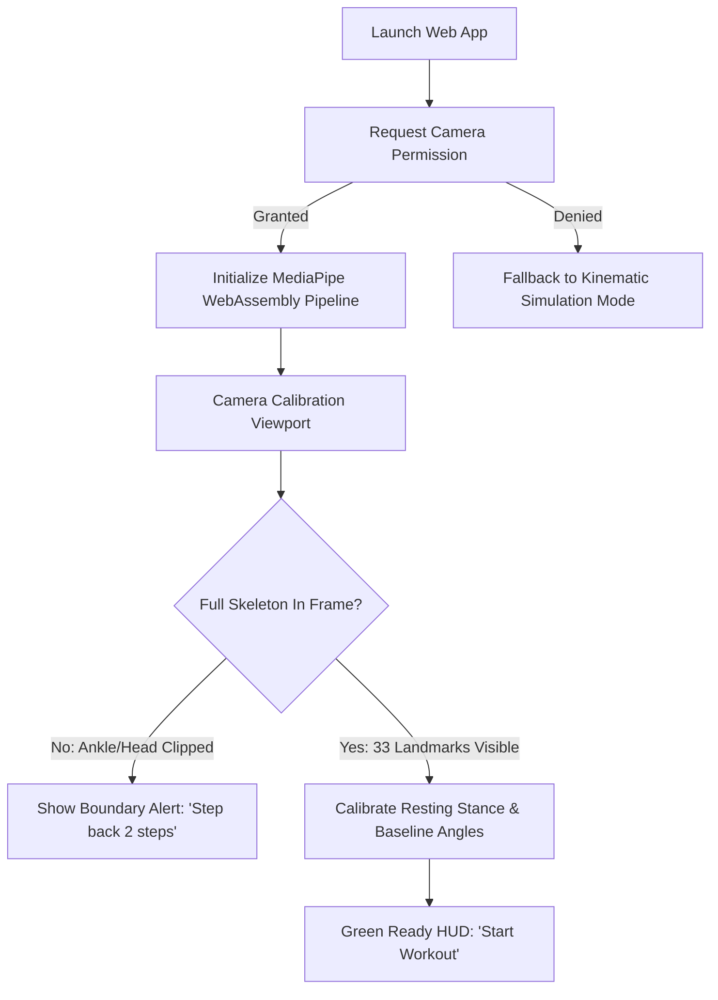
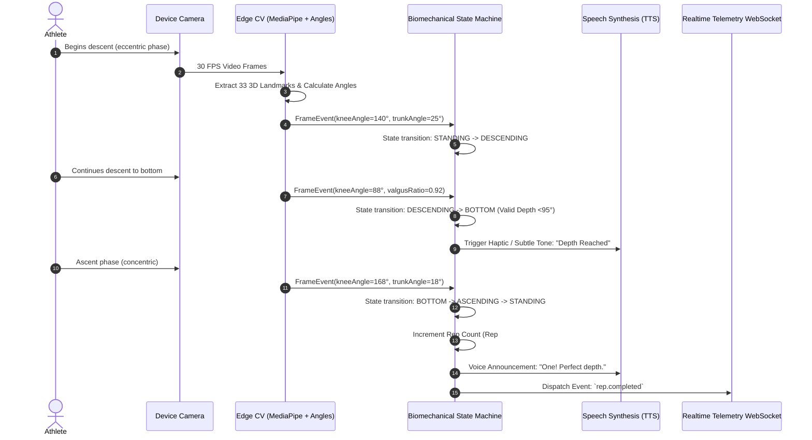
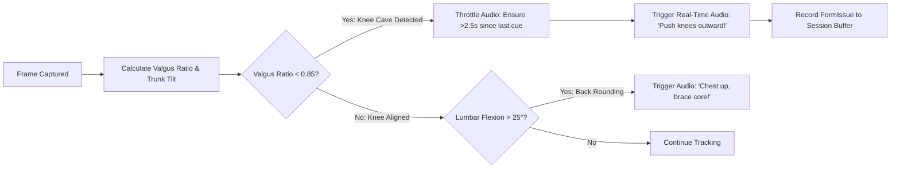

# End-to-End User Journeys

## Overview
This document specifies the step-by-step user experience across four primary flows: Camera Onboarding & Calibration, Live Squat Tracking Session, Real-Time In-Flight Coaching, and Post-Workout Review.

---

## Journey 1: Setup, Permissions & Camera Calibration

### Detailed Steps:
1. **Permission Handshake**: User opens application; app requests camera access with explicit privacy pledge ("All computer vision executes entirely on your device. Zero frames uploaded").
2. **Viewport Bounding Check**: System checks visibility confidence of 6 critical keypoints: nose, left/right hip, left/right knee, left/right ankle.
3. **Distance & Angle Guidance**: If ankles are truncated, audio cue announces: *"Step back slightly so feet and hips are fully visible."*
4. **Resting Baseline Capture**: Athlete stands in upright anatomical position for 1.5 seconds. Standing knee angle (~170°-180°) and trunk tilt baseline are locked into session state.

---

## Journey 2: Live Squat Workout Session & Kinematic State Transitions

---

## Journey 3: Real-Time Form Error Correction

---

## Journey 4: Post-Workout Biomechanical Review & Progress
1. **End Session Trigger**: Athlete presses "Complete Workout" or steps out of frame for >30 seconds.
2. **Session Aggregation**:
   - Total clean reps vs flagged reps.
   - Mean depth angle (e.g. 88.4°).
   - Valgus occurrence rate (e.g. 2 out of 15 reps).
   - Estimated caloric expenditure and anabolic strain index.
3. **AI Coach Debrief**: Generative coach ingests discrete session metrics and outputs structured feedback:
   - *Strengths*: "Exceptional depth consistency across sets 1 through 3."
   - *Biomechanical Focus*: "Reps 11-13 exhibited slight inward knee collapse on the concentric ascent."
   - *Actionable Cues*: "Incorporate banded goblet squats to reinforce gluteus medius recruitment."
